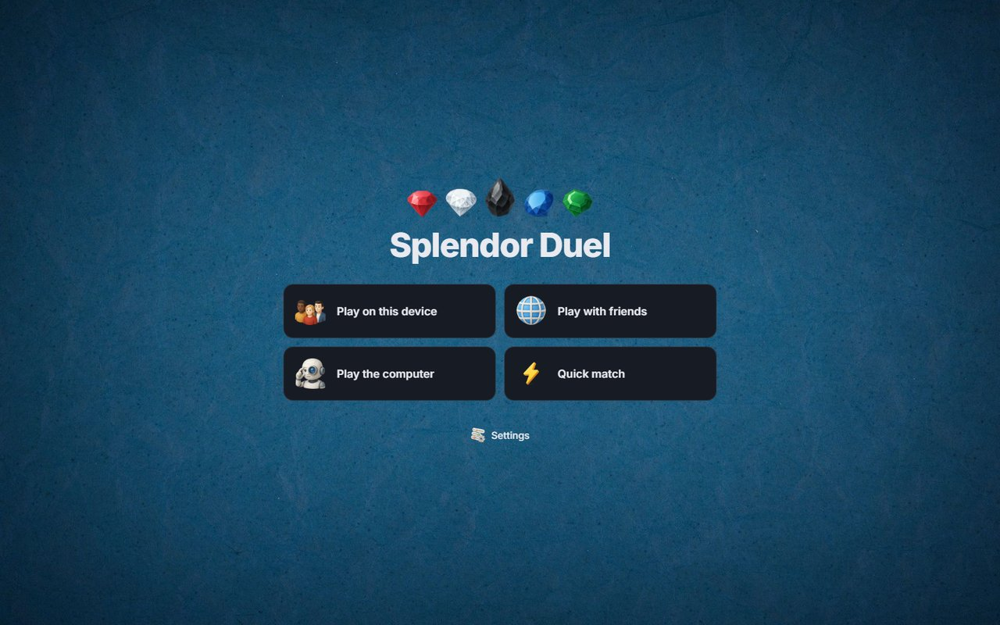
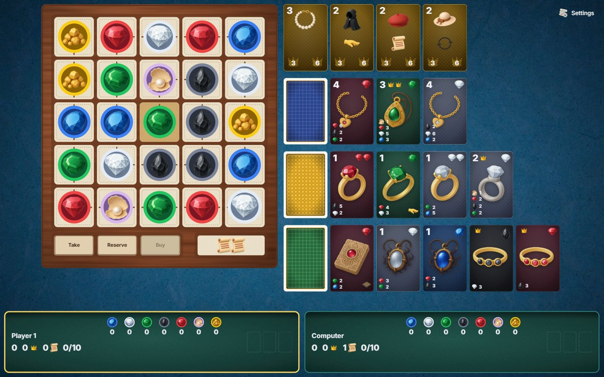

# Splendor Duel

A web version of the two-player board game Splendor Duel, with the Counterfeiters expansion. Play on one device, against the computer, or online with a friend or a stranger.

**Play it:** https://splendor-duel.danieldombrovsky9.workers.dev





## Features

- **Four ways to play:** pass-and-play on one device, a computer opponent with three difficulty levels, private online games with a friend, and quick match against a stranger.
- **Full rules:** tokens, privileges, royal cards, card abilities and the Counterfeiters expansion, all enforced by a deterministic rules engine.
- **Server-checked online games:** the same engine runs in the browser and in a Cloudflare Worker, so every online move is validated on the server.
- **Saved games:** online games are stored in Cloudflare D1 and can be resumed.

## Tech stack

React, Vite, Tailwind CSS and shadcn/ui in the browser, with a Cloudflare Worker and D1 on the server.

## Project layout

- `src/engine/` is the rules engine, shared by the browser and the Worker.
- `src/` holds the React app.
- `worker/` is the Cloudflare Worker that serves the game and stores online games. See `worker/README.md` for deploying.

## Running it locally

```
npm install
npm run dev
```
